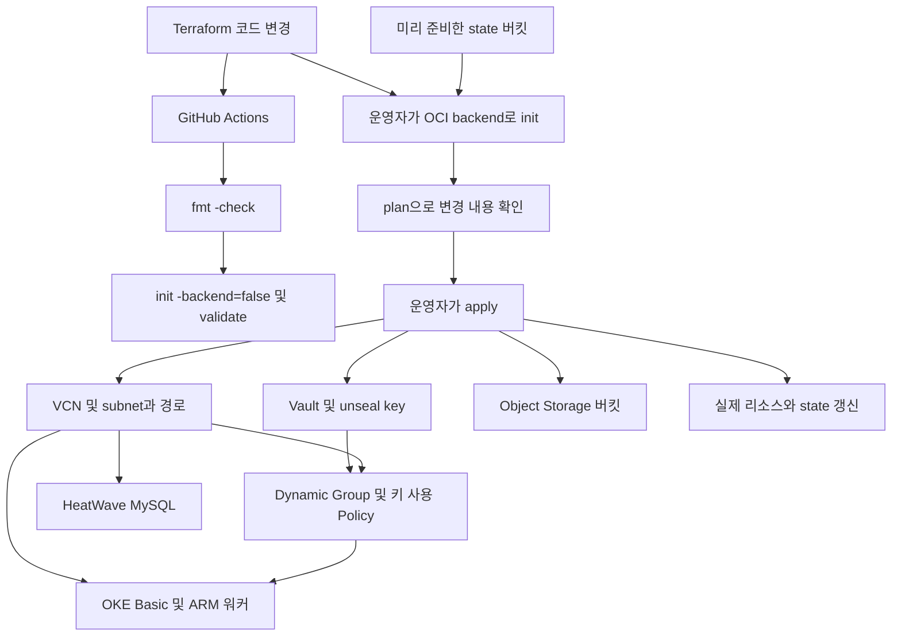
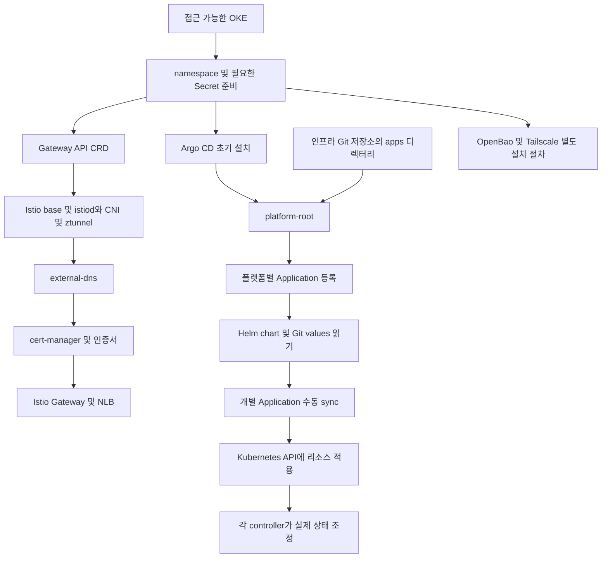
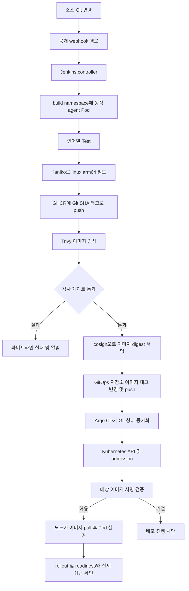

# 플랫폼의 파이프라인

기준일: **2026-10-16**. 소스 스냅샷·분석 범위는 [학습 안내](notes/oci-interview/00-overview.md)를 따른다. 아래 그래프의 워크로드는 플랫폼이 배포하는 일반적인 실행 단위다.

## 인프라 생성 파이프라인

GitHub Actions는 `fmt`와 `validate`를 수행한다. 실제 테넌트의 리소스 생성 가능성, 비용, 운영 상태까지 검증하지 않으며 `plan/apply` 단계도 워크플로에 없다. Terraform의 모듈 간 참조가 의존성을 만들기 때문에 파일의 위에서 아래 순서로 생성된다고 설명하면 안 된다.

OCI backend의 state 버킷은 `terraform init` 전에 필요하다. 이 스택의 `object-storage` 모듈이 자기 backend까지 자동 부트스트랩한다고 가정하지 않는다. state는 클라우드 리소스와 Terraform 주소의 대응을 보관하므로 자격증명 파일처럼 접근을 제한한다.

근거: [Terraform CI](https://github.com/GGingGGang/oci-always-free-k8s/blob/99b7238/.github/workflows/terraform-ci.yml), [모듈 연결](https://github.com/GGingGGang/oci-always-free-k8s/blob/99b7238/terraform/main.tf), [backend 준비](https://github.com/GGingGGang/oci-always-free-k8s/blob/99b7238/terraform/README.md).

## 플랫폼 부트스트랩과 GitOps

루트 `platform-root`의 `automated: {}`는 자식 Application 리소스를 자동 반영한다. Jenkins·KPS·Loki 등의 자식 Application에는 `automated`가 없으므로 그 안의 Helm 리소스 배포까지 모두 자동이라고 말할 수 없다. `sync-wave` 값도 자식 애플리케이션의 수동 배포 완료를 보장하지 않는다.

Helm chart 버전은 자식 Application의 `targetRevision`으로, 환경 설정은 이 저장소의 values로 관리한다. Argo CD의 Helm 연동을 설명할 때는 chart를 렌더링한 Kubernetes 리소스를 Argo CD가 동기화한다는 점을 짚는다.

OpenBao와 Tailscale은 현재 `argocd/apps`의 관리 대상에 없다. Secret·CRD·인증서 같은 선행 조건을 먼저 준비해야 한다는 점도 부트스트랩 책임에 포함된다.

근거: [설치 순서](https://github.com/GGingGGang/oci-always-free-k8s/blob/99b7238/kubernetes/infra/README.md), [platform-root](https://github.com/GGingGGang/oci-always-free-k8s/blob/99b7238/kubernetes/platform/argocd/root.yaml), [Jenkins Application](https://github.com/GGingGGang/oci-always-free-k8s/blob/99b7238/kubernetes/platform/argocd/apps/jenkins.yaml), [Loki Application](https://github.com/GGingGGang/oci-always-free-k8s/blob/99b7238/kubernetes/platform/argocd/apps/loki.yaml). 자동 sync·prune·selfHeal의 의미는 [Argo CD 공식 문서](https://argo-cd.readthedocs.io/en/stable/user-guide/auto_sync/) 참고. 공식 문서 작성일 미상, 열람 2026-10-16.

## 이미지 공급과 배포 파이프라인

이 흐름은 플랫폼의 Jenkins 설정과 공유 라이브러리의 공통 동작을 설명한다. 개별 애플리케이션의 테스트 내용은 다루지 않는다.

| 단계 | 실제 설정 | 면접에서 설명할 제약 |
| --- | --- | --- |
| 실행 위치 | controller executor 0, `build` namespace의 agent, 동시 agent 상한 2 | CI도 서비스와 같은 제한된 워커 자원을 소비한다 |
| 빌드 | Kaniko, 기본 플랫폼 `linux/arm64`, digest 파일 기록 | 이 설정만으로 AMD64·ARM64 동시 빌드가 되는 것은 아니다 |
| push | 이미지가 먼저 GHCR에 올라감 | 스캔 실패 이미지도 레지스트리에 남을 수 있다 |
| 검사 | 기본 CRITICAL, 수정 불가 취약점 제외, `scanGate: true` | “모든 취약점이 없다”는 보증은 아니다 |
| 서명 | 파일 기반 개인키, digest 대상, transparency log 업로드 비활성 | keyless 서명이 아니며 키 보관·회전 책임이 있다 |
| GitOps 갱신 | 배포 태그를 바꾸고 main에 직접 push, 경합 시 재시도 | 승인 PR을 만드는 파이프라인으로 설명하지 않는다 |
| 배포 검증 | Kyverno 대상 namespace·이미지에 Enforce | 정책 적용 범위 밖 이미지까지 검증한다고 가정하지 않는다 |
| 완료 판정 | Jenkins는 Git push까지, Argo Sync·Health와 rollout은 별도 | CI 성공만으로 서비스 정상까지 선언하지 않는다 |

Git SHA 태그는 추적성을 주지만 태그를 재지정할 수 없도록 자동 보장하지는 않는다. 현재 Kyverno의 `mutateDigest: false`, `verifyDigest: false`를 고려하면 이미지 digest 고정과 서명 검증을 각각 설명해야 한다.

근거: [Jenkins 설정](https://github.com/GGingGGang/oci-always-free-k8s/blob/99b7238/kubernetes/platform/jenkins/values.yaml), [공통 CI](https://github.com/GGingGGang/jenkins-shared-library/blob/f762a6d/vars/ci.groovy), [빌드](https://github.com/GGingGGang/jenkins-shared-library/blob/f762a6d/vars/kanikoBuild.groovy), [검사](https://github.com/GGingGGang/jenkins-shared-library/blob/f762a6d/vars/trivyImageScan.groovy), [서명](https://github.com/GGingGGang/jenkins-shared-library/blob/f762a6d/vars/cosignSign.groovy), [태그 갱신](https://github.com/GGingGGang/jenkins-shared-library/blob/f762a6d/vars/deployBump.groovy), [배포 정책](https://github.com/GGingGGang/oci-always-free-k8s/blob/99b7238/kubernetes/platform/kyverno/policies/verify-image-signature.yaml).

## 롤백을 설명하는 순서

1. 이미지·매니페스트 변경이 원인인지 Argo diff, 이벤트, 이전 버전과 비교한다.
2. GitOps의 desired state를 검증된 이전 값으로 되돌려 동기화한다.
3. Pod 상태·readiness·실제 접근을 확인한다.
4. 데이터와 외부 상태의 변경은 별도 복구 대상으로 다룬다. 이미지 롤백이 데이터 복구를 대신하지 않는다.

이 절차는 면접용 운영 제안이며 현재 저장소에 롤백 성공을 검증한 자동화가 있다는 뜻은 아니다.
