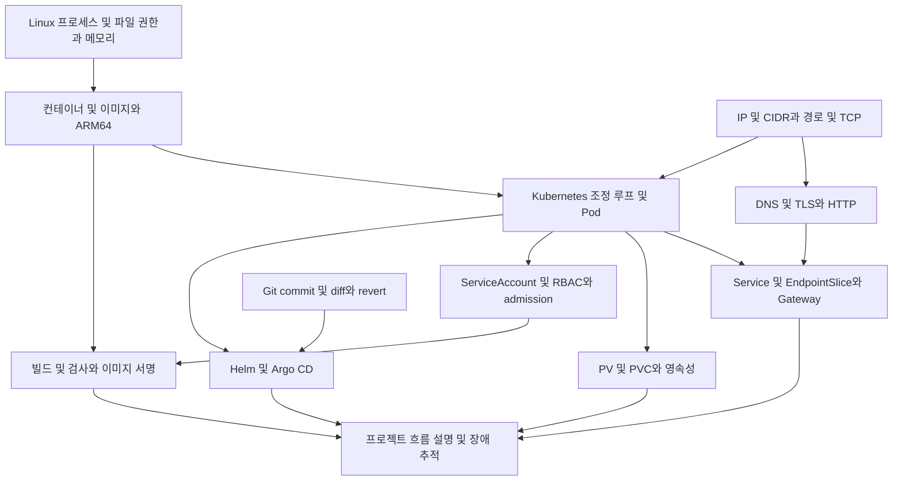

# 정말 필요한 사전 지식

기준일: **2026-10-16**. 목표는 도구 이름 암기보다 “어느 계층에서 무엇이 실패했는가”를 설명하는 것이다. 프로젝트 설정의 근거는 [기술 스택 표](notes/oci-interview/00-overview.md)에 연결했다.

## 학습 의존성

## 반드시 설명해야 하는 개념

| 우선순위 | 최소 개념 | 이 프로젝트에서 필요한 이유 | 통과 기준 |
| --- | --- | --- | --- |
| 최우선 | 프로세스, SIGTERM, uid/gid, 파일 권한 | non-root, readOnlyRootFilesystem, 공유 볼륨 권한 | 프로세스 종료와 Pod 교체를 구별하고 권한 오류 위치를 설명한다 |
| 최우선 | CPU·메모리 requests/limits | 작은 ARM 노드에 플랫폼·CI가 함께 실행 | Pending, CPU 제한, OOMKilled의 차이를 말한다 |
| 최우선 | CIDR, route, TCP 포트, NAT, 방화벽 | 네 서브넷과 세 Gateway가 서로 다른 경로 담당 | 목적지에 따라 IGW·NAT·Service Gateway·VCN 내부 경로를 고른다 |
| 최우선 | DNS 질의, TLS 인증서·SAN·종료, HTTP host/path | Cloudflare, cert-manager, NLB, Istio가 연결 | DNS 성공과 HTTPS 성공을 구별한다 |
| 최우선 | image tag·digest, registry, CPU architecture | ARM64 빌드·GHCR pull·cosign 서명 | 태그 추적성과 내용 식별의 차이를 설명한다 |
| 최우선 | Kubernetes API, desired/current state, controller | Terraform 뒤 플랫폼 설치와 GitOps가 이어짐 | kubectl apply 이후 누가 실제 Pod를 만드는지 말한다 |
| 최우선 | Deployment·ReplicaSet·Pod·Service·EndpointSlice | 배포·상태 점검·트래픽 전달의 기본 | Pod Ready가 Service 대상 선정에 어떻게 연결되는지 설명한다 |
| 최우선 | CRD와 controller, Gateway API와 Istio | API 선언과 실제 구현을 혼동하기 쉬움 | Gateway 리소스만 있다고 트래픽 처리가 되는 것은 아님을 설명한다 |
| 필수 | Git, Terraform state, plan/apply, drift | 인프라 복구와 변경 추적의 기초 | Git 코드·state·실제 OCI 리소스를 각각 설명한다 |
| 필수 | Helm chart·values·버전, Argo diff/sync/health | 플랫폼은 외부 chart와 Git values로 구성 | 차트 버전과 이미지 버전, 부모·자식 sync를 구별한다 |
| 필수 | ServiceAccount, Role·RoleBinding, PSA | Jenkins controller와 build agent의 권한 분리 | 어느 주체가 어느 namespace에 어떤 API 작업을 하는지 답한다 |
| 필수 | PV·PVC·StorageClass·RWO·emptyDir·백업 | NATS·Prometheus·Loki·OpenBao의 보존 특성 | 재시작·Pod 재생성·노드 장애·볼륨 유실 때 차이를 설명한다 |
| 필수 | scrape, 시계열 label, 로그, alert rule | Prometheus·Loki·Alertmanager의 역할 분담 | 메트릭과 로그의 수집 경로 및 알림 원천을 나눈다 |

## 꼭 알아야 할 구분 여덟 가지

**1. API 제어 경로와 사용자 데이터 경로.** kubectl·Argo CD는 Kubernetes API로 리소스를 제어한다. 일반 HTTP 요청은 NLB·Gateway·Service를 향한다. 모든 요청이 API server를 통과하는 구조가 아니다.

**2. 연결 경로와 접근 허용.** route가 있어도 Security List·NSG가 막으면 통신할 수 없다. Security List와 NSG를 모두 통과해야 하는 연속된 차단 장벽으로 단순화하지 않는다. 실제 적용되는 허용 규칙과 stateful 여부를 확인해야 한다. 이 프로젝트의 worker egress는 넓게 허용되어 있으므로 최소 허용만 구현했다고 설명하지 않는다. [networking 소스](https://github.com/GGingGGang/oci-always-free-k8s/blob/99b7238/terraform/modules/networking/main.tf)

**3. DNS 레코드와 인증서.** external-dns는 HTTPRoute 기반 주소 레코드를 관리한다. cert-manager는 ACME DNS-01 검증용 TXT 레코드와 인증서 수명을 관리한다. external-dns TXT registry는 레코드 소유권 추적용이며 ACME challenge와 목적이 다르다. [external-dns 공식 문서](https://kubernetes-sigs.github.io/external-dns/latest/docs/sources/gateway-api/), [cert-manager 공식 문서](https://cert-manager.io/docs/configuration/acme/dns01/)

**4. 외부 TLS와 메시 mTLS.** Gateway가 종료하는 공개 HTTPS와 ambient의 워크로드 간 암호화는 경계·인증 주체가 다르다. ztunnel은 L4 연결을 다루며, L7 기능에는 waypoint 등 별도 구성이 필요하다. 현재 label만으로 STRICT 강제·세밀한 인가·L7 관측까지 완료했다고 볼 수 없다. [Istio ambient 공식 문서](https://istio.io/latest/docs/ambient/architecture/data-plane/)

**5. Secret과 KMS와 OpenBao.** Kubernetes Secret은 Pod에 값을 전달하는 API 리소스다. OCI KMS는 이 구성에서 OpenBao unseal에 쓰는 키를 제공한다. OpenBao의 Raft 데이터를 보관하는 공간은 별도다. auto-unseal이 되더라도 유실된 Raft 데이터를 되살릴 수 없다. [OpenBao seal 공식 문서](https://openbao.org/docs/concepts/seal/)

**6. CI 검사와 admission 검사.** Trivy는 CI에서 취약점을 찾고, cosign은 특정 이미지 내용에 서명한다. Kyverno는 배포 요청 시 정책에 따라 서명을 확인한다. 신뢰하는 키로 서명했다는 사실이 취약점 부재를 증명하지 않는다.

**7. PVC와 복제와 백업.** PVC는 저장 공간 사용 요청이다. 저장 공간이 살아 있어도 단일 노드 배치나 애플리케이션 1 replica가 가용성을 제한할 수 있다. `Retain`은 삭제 시 보존 정책이며 별도 복사본이나 복구 검증을 만들지 않는다.

**8. 구성 복원과 데이터 복원.** Git과 JCasC로 설정을 재구성할 수 있어도 Jenkins의 과거 실행 이력이나 OpenBao 데이터까지 복원되는 것은 아니다. 어떤 데이터가 없어져도 되는지부터 정해야 한다.

외부 공식 문서는 작성일 미상, 열람일 **2026-10-16**. 개념 설명을 현재 저장소의 구현 증거와 동일하게 취급하지 않는다.

## 지금 깊게 공부할 필요가 낮은 항목

Thanos 장기 보관, Tempo 기반 분산 추적, Kiali, Kafka/Strimzi, Cilium 전환, 커스텀 메트릭 HPA는 이번 분석 대상의 실제 배포 구성을 설명하는 데 선행 조건이 아니다. 기본 경로와 영속성·권한을 설명한 다음 필요에 따라 확장한다. 설치했다고 면접 답변에 넣지 않는다.

## 기존 노트로 보충하기

- Linux가 약하면 [네트워크](notes/linux/11-네트워크.md), [프로세스와 시그널](notes/linux/07-프로세스와-시그널.md), [컨테이너를 이해하는 Linux](notes/linux/16-컨테이너를-이해하는-리눅스.md).
- Kubernetes가 약하면 [클러스터 아키텍처](notes/cka/01-쿠버네티스-아키텍처.md), [Pod 네트워킹과 Service](notes/cka/13-Pod네트워킹과-Service.md), [스토리지](notes/cka/17-스토리지-PV-PVC-StorageClass.md).
- 현재 프로젝트에 적용됐는지의 판단은 기존 로드맵 노트보다 이번 문서의 소스 링크를 우선한다.

## 자가 점검

1. `ci-hook.ggang.cloud`의 DNS는 정상이지만 webhook이 실패할 때 어디부터 확인하는가?
2. Jenkins 빌드는 성공했는데 Pod가 바뀌지 않을 수 있는 이유 세 가지는?
3. Loki가 새 PVC 없이 Prometheus PVC를 쓰는 이유와 위험은?
4. OpenBao Pod가 교체되면 KMS가 살아 있어도 어떤 문제가 생길 수 있는가?
5. 워커 두 대가 있다는 사실만으로 고가용성을 주장할 수 없는 이유는?

답을 도구 목록으로 나열하지 않고 [데이터 흐름](notes/oci-interview/03-data-flows.md)에 표시된 연결을 따라 설명하면 된다.
