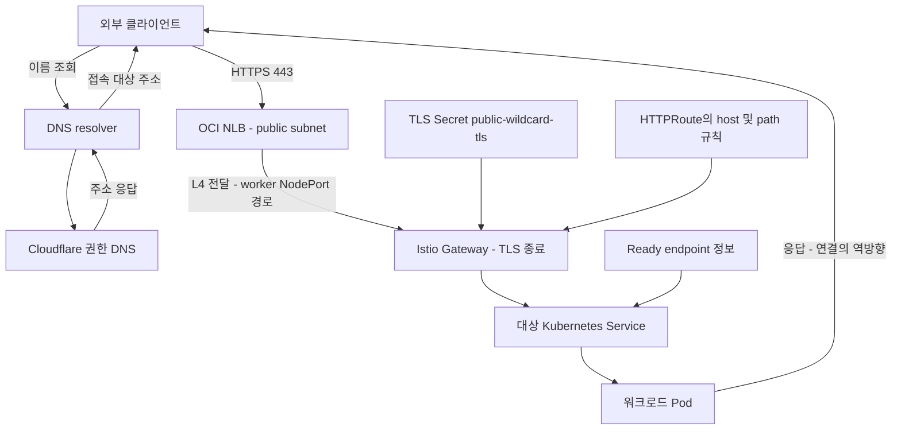
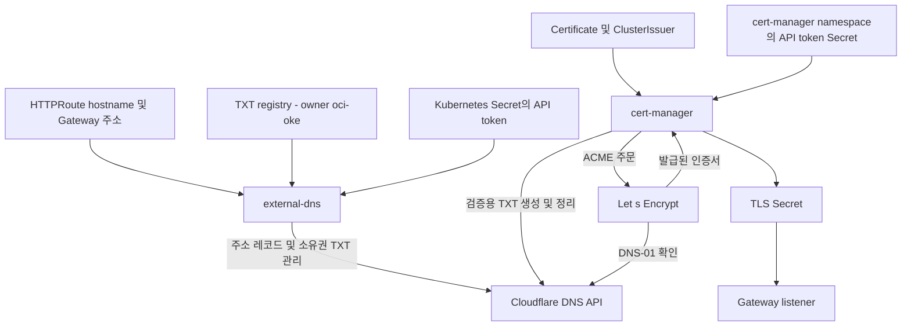
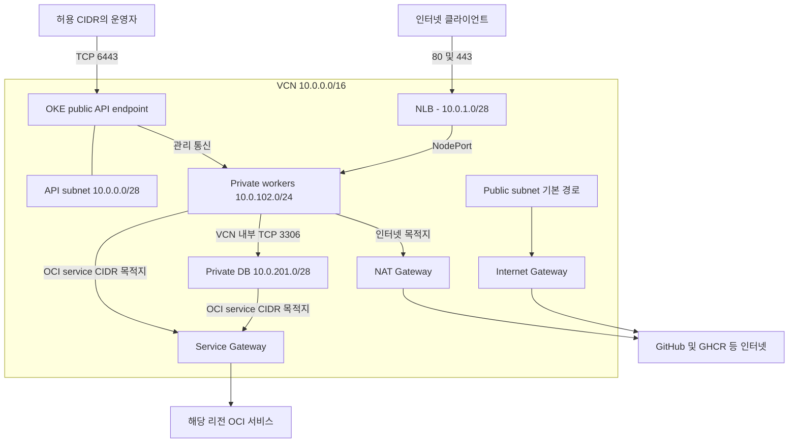
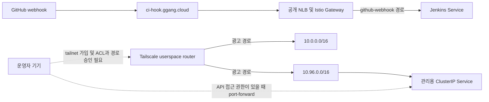
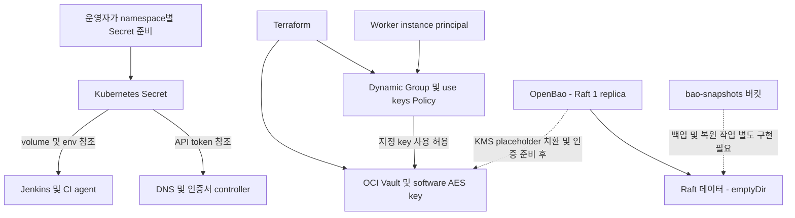
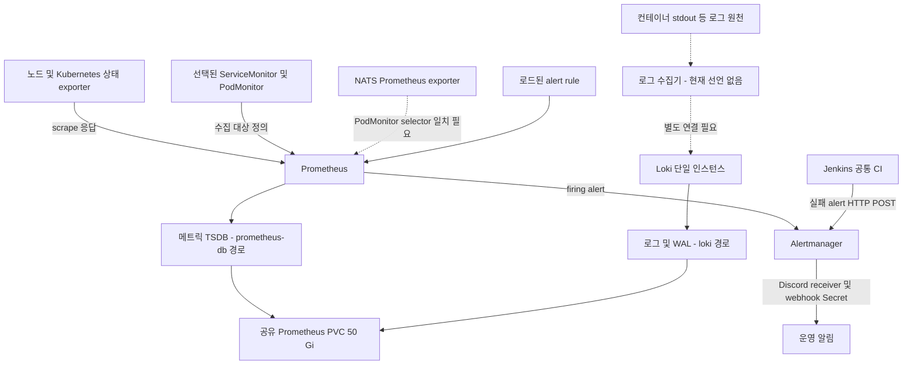

# 인프라와 플랫폼의 데이터 흐름

기준일: **2026-10-16**. 업무 데이터와 개별 애플리케이션 로직은 제외한다. 구성 근거와 소스 시점은 [학습 안내](notes/oci-interview/00-overview.md)를 따른다.

실선은 설정으로 확인한 연결·참조, 점선은 별도 설정이나 확인이 필요한 연결이다. 그래프는 논리적 경로이며 실행 중인 클러스터의 패킷을 관측한 결과가 아니다.

## 외부 요청: DNS 조회부터 워크로드까지

Cloudflare는 여기서 권한 DNS 역할로 표현했다. CDN 프록시·WAF가 모든 요청 앞에 있다는 사실은 이 설정으로 확인하지 않았다. 응답 화살표는 연결의 역방향을 줄여 그린 것이며 중간 계층을 우회한다는 뜻이 아니다. Service 역시 독립적인 프록시 프로세스로 단정하지 않고 논리적인 대상 선택 계층으로 읽는다.

NLB는 Gateway의 infrastructure annotation으로 요청하고, HTTPS는 Gateway listener의 `Terminate`와 TLS Secret 참조로 처리한다. HTTP 80 경로에는 HTTPS redirect 구성이 별도로 있다. 이 요청은 Kubernetes API server를 통과하지 않는다.

근거: [Gateway](https://github.com/GGingGGang/oci-always-free-k8s/blob/99b7238/kubernetes/infra/istio/gateway.yaml), [redirect](https://github.com/GGingGGang/oci-always-free-k8s/blob/99b7238/kubernetes/infra/istio/http-redirect.yaml), [네트워크 규칙](https://github.com/GGingGGang/oci-always-free-k8s/blob/99b7238/terraform/modules/networking/main.tf).

## 주소 레코드와 인증서 발급

external-dns는 `gateway-httproute`, `gateway-grpcroute`를 감시하며 `policy: sync`, `registry: txt`를 사용한다. cert-manager는 별도의 ACME DNS-01 solver로 도메인 소유권을 증명한다. 둘 다 Cloudflare를 사용하지만 TXT 레코드의 목적과 관리 주체가 다르다. Secret은 namespace별 객체이므로 이름이 같아도 자동 공유되지 않는다.

인증서 발급이 막히면 Certificate → CertificateRequest → Order → Challenge 상태와 DNS 전파를 확인한다. external-dns가 주소를 등록했다는 사실만으로 인증서 발급까지 성공한 것은 아니다.

근거: [external-dns values](https://github.com/GGingGGang/oci-always-free-k8s/blob/99b7238/kubernetes/infra/external-dns/values.yaml), [ClusterIssuer](https://github.com/GGingGGang/oci-always-free-k8s/blob/99b7238/kubernetes/infra/cert-manager/cluster-issuer.yaml), [Certificate](https://github.com/GGingGGang/oci-always-free-k8s/blob/99b7238/kubernetes/infra/cert-manager/certificate.yaml). 개념: [external-dns Gateway source](https://kubernetes-sigs.github.io/external-dns/latest/docs/sources/gateway-api/), [cert-manager DNS-01](https://cert-manager.io/docs/configuration/acme/dns01/). 공식 문서 작성일 미상, 열람 2026-10-16.

## VCN 경로: 관리·인입·외부 통신·DB 통신

| 목적 | 선택되는 논리 경로 | 함께 확인할 조건 |
| --- | --- | --- |
| 외부 운영자 → API | public endpoint의 6443 | endpoint NSG의 `allowed_cidr`, 인증, Kubernetes RBAC |
| 인터넷 → 공개 서비스 | public NLB → worker NodePort → Gateway | NLB backend health, Security List, Gateway 및 route 상태 |
| worker → GitHub·GHCR | worker 기본 경로 → NAT | DNS, worker egress, registry 인증 |
| worker → OCI service CIDR | Service Gateway 경로 | 대상이 해당 서비스 CIDR에 포함되는지, IAM |
| worker → HeatWave | VCN 내부 경로 | DB subnet 3306 허용, 사용자 권한, DB TLS |

DB의 MySQL 데이터 통신이 Service Gateway를 경유하는 것은 아니다. 또한 NSG에 HTTP·HTTPS 허용 규칙이 있다는 이유만으로 NLB에 해당 NSG가 연결되어 있다고 해석하지 않는다. 이 코드에서 OKE endpoint의 NSG 연결은 명시적으로 확인된다.

근거: [route·subnet·Security List](https://github.com/GGingGGang/oci-always-free-k8s/blob/99b7238/terraform/modules/networking/main.tf), [endpoint NSG 연결](https://github.com/GGingGGang/oci-always-free-k8s/blob/99b7238/terraform/main.tf), [NSG와 IAM](https://github.com/GGingGGang/oci-always-free-k8s/blob/99b7238/terraform/modules/iam/main.tf).

## 관리 UI와 Jenkins webhook의 경계

Jenkins는 공개 webhook용 HTTPRoute가 활성이고 관리 UI용 HTTPRoute는 주석 처리되어 있다. Tailscale은 VCN·Service CIDR을 광고하지만, 이 선언만으로 tailnet의 ACL·route 승인과 실제 접속이 완료됐다고 볼 수 없다. Pod CIDR `10.244.0.0/16`은 광고 경로 목록에 없다.

근거: [Jenkins route](https://github.com/GGingGGang/oci-always-free-k8s/blob/99b7238/kubernetes/platform/jenkins/httproute.yaml), [Tailscale Deployment](https://github.com/GGingGGang/oci-always-free-k8s/blob/99b7238/kubernetes/infra/tailscale/deployment.yaml).

## Secret 전달과 OpenBao auto-unseal

Secret 이름과 참조 경로는 구성으로 확인할 수 있지만 실제 비밀값은 문서화하지 않는다. OpenBao injector 활성화가 모든 Secret 소비 경로의 OpenBao 전환을 뜻하지도 않는다.

KMS Policy는 특정 키 사용으로 제한하지만 Dynamic Group은 해당 compartment의 인스턴스를 매칭한다. “워크로드 하나에만 부여한 신원”으로 과장하지 않는다. `emptyDir`는 컨테이너 재시작 시 유지될 수 있어도 Pod가 제거되면 데이터가 사라진다. 단일 Raft replica와 KMS가 데이터 유실을 해결하지 않는다.

근거: [OpenBao values](https://github.com/GGingGGang/oci-always-free-k8s/blob/99b7238/kubernetes/platform/openbao/values.yaml), [KMS](https://github.com/GGingGGang/oci-always-free-k8s/blob/99b7238/terraform/modules/kms/main.tf), [IAM](https://github.com/GGingGGang/oci-always-free-k8s/blob/99b7238/terraform/modules/iam/main.tf), [버킷 기본값](https://github.com/GGingGGang/oci-always-free-k8s/blob/99b7238/terraform/variables.tf).

## 메트릭·알림·로그의 흐름

Prometheus는 15일·45 GiB retention 설정을 사용하고 Loki는 72시간 retention을 사용한다. **같은 50 Gi PVC를 쓰므로 보존 설정은 용량 격리나 여유 공간 보장이 아니다.** Loki의 추가 기록과 WAL이 디스크 공간을 소비하면 메트릭 저장에도 영향을 줄 수 있다. 두 워크로드의 동일 노드 라벨 배치 요구와 볼륨 연결 제약도 함께 봐야 한다.

Grafana는 비활성이다. Loki 저장소 설정이 있어도 수집기가 없으면 컨테이너 로그가 자동 적재되지 않는다. Jenkins 실패 알림은 Prometheus scrape 경로를 거치지 않고 Alertmanager API에 직접 전달하는 별도 경로다.

근거: [KPS values](https://github.com/GGingGGang/oci-always-free-k8s/blob/99b7238/kubernetes/platform/monitoring/kps/values.yaml), [Loki values](https://github.com/GGingGGang/oci-always-free-k8s/blob/99b7238/kubernetes/platform/monitoring/loki/values.yaml), [공유 저장소 절차](https://github.com/GGingGGang/oci-always-free-k8s/blob/99b7238/kubernetes/platform/monitoring/loki/README.md), [NATS exporter](https://github.com/GGingGGang/oci-always-free-k8s/blob/99b7238/kubernetes/platform/nats/values.yaml), [알림 receiver](https://github.com/GGingGGang/oci-always-free-k8s/blob/99b7238/kubernetes/platform/monitoring/kps/alertmanager-config.yaml), [CI 실패 알림](https://github.com/GGingGGang/jenkins-shared-library/blob/f762a6d/vars/ci.groovy).

## 저장 데이터의 보존 경계

| 구성 요소 | 선언된 보관 방식 | Pod 교체·장애를 설명할 때 확인할 것 |
| --- | --- | --- |
| HeatWave | 관리형 MySQL, 50 GB | Terraform은 삭제 보호 false, 최종 백업 생략, 자동 백업 retention 삭제 설정. 실제 백업 정책과 복구 가능 여부는 별도 확인 |
| Redis | `emptyDir`, RDB·AOF 비활성 | 컨테이너 파일보다 메모리가 데이터 원천. 프로세스 재시작만으로도 데이터가 사라질 수 있음 |
| NATS | JetStream file store, 50 Gi PVC, cluster 비활성 | 영속 디스크는 있으나 브로커 복제 구성은 없음 |
| Prometheus·Loki | 동일 50 Gi PVC의 별도 경로 | 디스크 여유·노드 배치·볼륨 장애를 공유 |
| OpenBao | Raft, `emptyDir`, 1 replica | Pod 재생성 시 Raft 유실 가능, snapshot 버킷만으로 복구 불가 |
| Jenkins | `persistence.enabled: false`, JCasC | 재구성 가능한 설정과 소실될 실행 이력·산출물 구별 |

근거: [DB](https://github.com/GGingGGang/oci-always-free-k8s/blob/99b7238/terraform/modules/database/main.tf), [Redis](https://github.com/GGingGGang/oci-always-free-k8s/blob/99b7238/kubernetes/platform/redis/redis.yaml), [NATS](https://github.com/GGingGGang/oci-always-free-k8s/blob/99b7238/kubernetes/platform/nats/values.yaml), 나머지는 위 단락의 각 values 파일.
